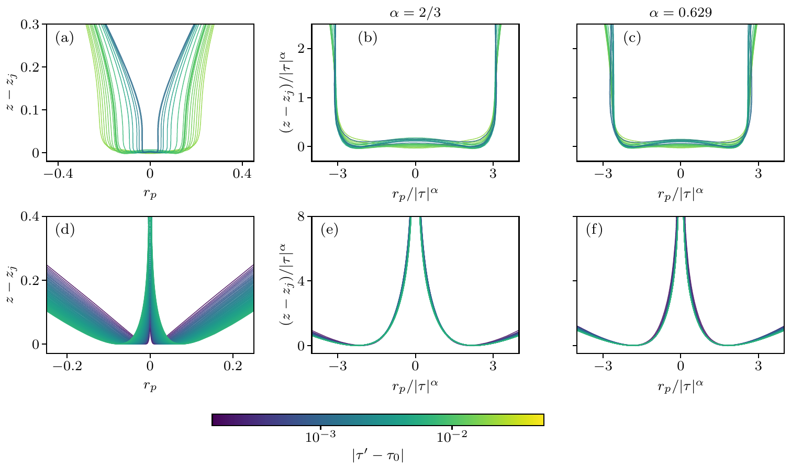
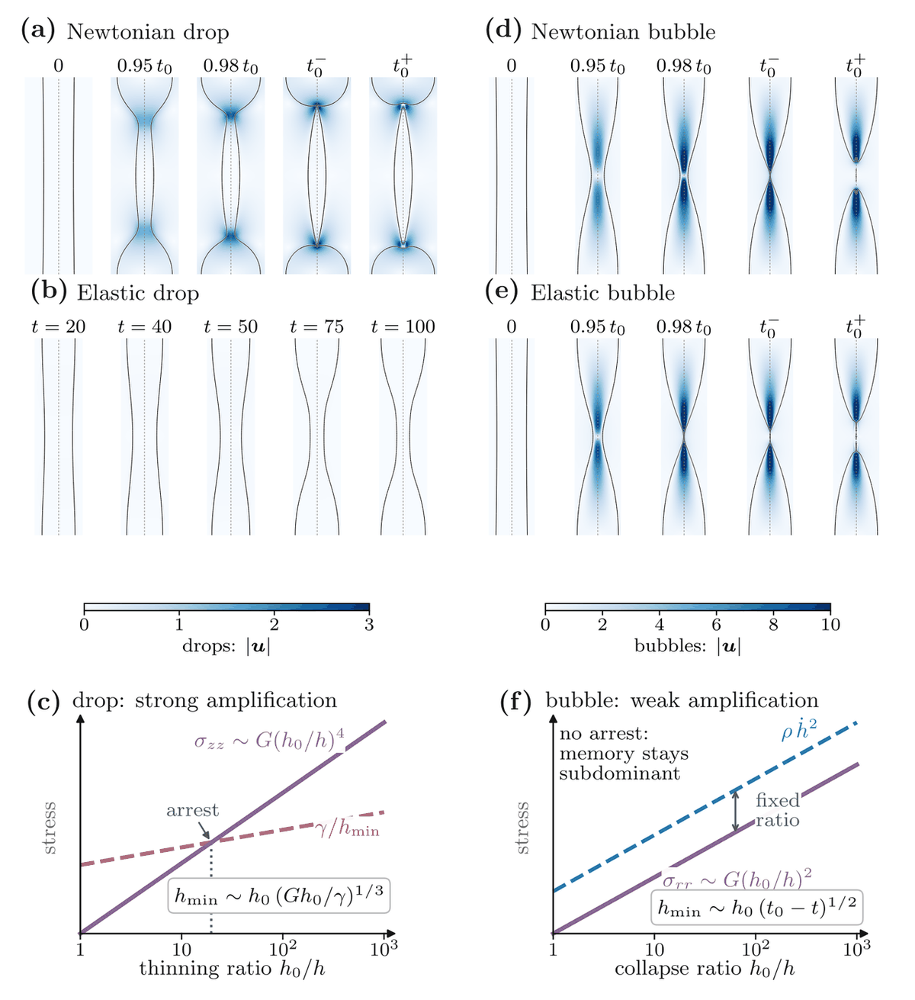
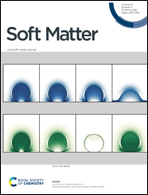
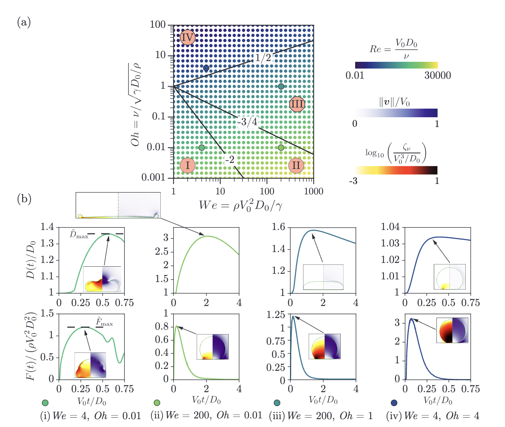
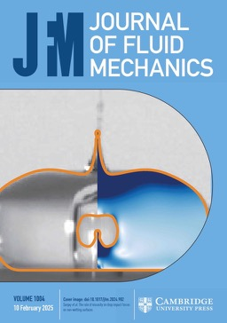
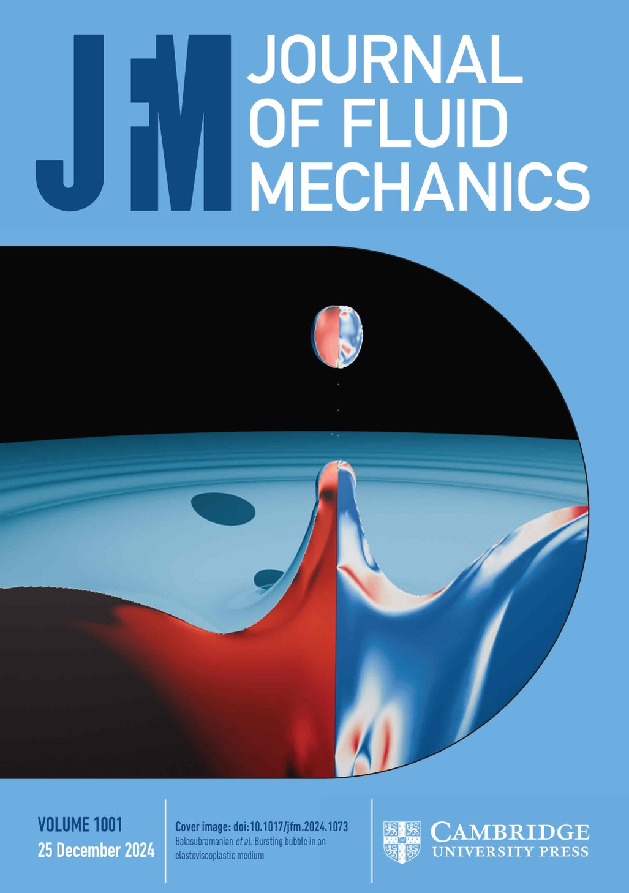

## Sort by topic

<button type="button" aria-pressed="false">Bubbles</button>

<button type="button" aria-pressed="false">Drops</button>

<button type="button" aria-pressed="false">Jets</button>

<button type="button" aria-pressed="false">Sheets</button>

<button type="button" aria-pressed="false">Non-Newtonian</button>

<button type="button" aria-pressed="false">Coalescence</button>

<button type="button" aria-pressed="false">Superamphiphobic-surfaces</button>

<button type="button" aria-pressed="false">Impact forces</button>

<button type="button" aria-pressed="false">Dissipative anomaly</button>

<button type="button" aria-pressed="false">Soft-matter-singularities</button>

<button type="button" aria-pressed="false">Elastic beads</button>

<button type="button" aria-pressed="false">Bouncing</button>

<button type="button" aria-pressed="false">Rupture</button>

<button type="button" aria-pressed="false">Contact line</button>

<button type="button" aria-pressed="false">Marangoni flows</button>

<button type="button" aria-pressed="false">Numerical methods</button>

<button type="button" aria-pressed="false">Featured</button>

## Work in Progress

### Gordillo, J. M., Rodríguez-Rodríguez, J., & <strong>Sanjay, V.</strong> Self-similar Worthington jets. arXiv preprint arXiv:2607.08972 (2026). {#self-similar-worthington-jets}

<button type="button" aria-pressed="false">Bubbles</button><button type="button" aria-pressed="false">Jets</button><button type="button" aria-pressed="false">Soft-matter-singularities</button><button type="button" aria-pressed="false">Featured</button>

<a class="chip" href="https://arxiv.org/abs/2607.08972">arXiv · 2607.08972</a>
<a class="chip" href="https://github.com/comphy-lab/Bursting-Bubble">GitHub</a>

{: width="75%" .center-block style="display: block; margin-left: auto; margin-right: auto;"}

<iframe width="560" height="315" src="https://www.youtube-nocookie.com/embed/cCzpLutubF4?rel=0" title="Self-similar Worthington jets — full video" frameborder="0" allow="accelerometer; autoplay; clipboard-write; encrypted-media; gyroscope; picture-in-picture; web-share" referrerpolicy="strict-origin-when-cross-origin" allowfullscreen></iframe>

### Yang, Z., <strong>Sanjay, V.</strong>, Constante-Amores, C. R., & Feng, J. Confinement-Induced Suppression of Jet Drop Size by Bubble Bursting in Shallow Liquids. arXiv preprint arXiv:2606.28609 (2026).

<button type="button" aria-pressed="false">Bubbles</button><button type="button" aria-pressed="false">Jets</button><button type="button" aria-pressed="false">Drops</button><button type="button" aria-pressed="false">Soft-matter-singularities</button>

<a class="chip" href="https://arxiv.org/abs/2606.28609">arXiv · 2606.28609</a>

### Ghaemi, A. H., Yang, Z., Huang, A., <strong>Sanjay, V.</strong>, Feng, J., & Constante-Amores, C. R. Bursting bubbles in Herschel-Bulkley fluids: dynamics and jetting transitions. arXiv preprint arXiv:2511.23345 (2025).

<button type="button" aria-pressed="false">Bubbles</button><button type="button" aria-pressed="false">Non-Newtonian</button><button type="button" aria-pressed="false">Jets</button>

<a class="chip" href="https://arxiv.org/abs/2511.23345">arXiv · 2511.23345</a>
<a class="chip" href="https://github.com/comphy-lab/BurstingBubble_Herschel-Bulkley/">GitHub</a>
<a class="chip" href="https://blogs.comphy-lab.org/">Blog · Coming Soon</a>

## 2026

<h3 id="26">[26] <strong>Sanjay, V.</strong> Singularities in Soft Matter Systems. Contemporary Physics (2026).</h3>

<button type="button" aria-pressed="false">Soft-matter-singularities</button><button type="button" aria-pressed="false">Featured</button>

<a class="chip" href="https://doi.org/10.1080/00107514.2026.2721118">Contemporary Physics · DOI: 10.1080/00107514.2026.2721118</a>
<a class="chip" href="https://arxiv.org/abs/2608.11060">arXiv · 2608.11060</a>

{: width="75%" .center-block style="display: block; margin-left: auto; margin-right: auto;"}

<h3 id="25">[25] Verschuur, C. I., Oratis, A. T., <strong>Sanjay, V.</strong>, & Snoeijer, J. H. How elasticity affects bubble pinch-off. Phys. Rev. Fluids, 11, 073302 (2026).</h3>

<button type="button" aria-pressed="false">Bubbles</button><button type="button" aria-pressed="false">Soft-matter-singularities</button><button type="button" aria-pressed="false">Elastic beads</button>

<a class="chip" href="https://doi.org/10.1103/5sp3-k5l2">PRF · DOI: 10.1103/5sp3-k5l2</a>
<a class="chip" href="https://arxiv.org/abs/2511.20075">arXiv · 2511.20075</a>
<a class="chip" href="/assets/videos/elasticity-bubble-pinch-off.mp4">Video · mp4</a>
<a class="chip" href="https://github.com/comphy-lab/ElasticPinchOff/">GitHub</a>
<a class="chip" href="https://blogs.comphy-lab.org/">Blog · Coming Soon</a>

  

    
  

  

    <video
      autoplay
      muted
      loop
      playsinline
      controls
      preload="metadata"
      poster="/assets/images/research/elasticity-bubble-pinch-off-poster.png"
      title="Viscoelastic bubble pinch-off (Ec=0.1, Oh=0.01)"
    >
      <source
        src="/assets/videos/elasticity-bubble-pinch-off.mp4"
        type="video/mp4"
      />
    </video>
  

<h3 id="24">[24] Appleford, T., <strong>Sanjay, V.</strong>, & Jalaal, M. Rheology of Two-Dimensional Dilute Emulsions. Phys. Rev. Fluids, 11, 033607 (2026).</h3>

<button type="button" aria-pressed="false">Emulsions</button><button type="button" aria-pressed="false">Rheology</button>

<a class="chip" href="https://doi.org/10.1103/9dgt-rkp5">PRF · DOI: 10.1103/9dgt-rkp5</a>
<a class="chip" href="https://arxiv.org/abs/2508.13022">arXiv · 2508.13022</a>
<a class="chip" href="https://github.com/tappleford/droplet_under_shear_newtonian_2D">GitHub</a>
<a class="chip" href="https://blogs.comphy-lab.org/">Blog · Coming Soon</a>

<h3 id="23">[23] <strong>Jana, S.</strong>, Kolinski, J., Lohse, D., & <strong>Sanjay, V.</strong> Impacting spheres: from liquid drops to elastic beads. Soft Matter, 22, 2226-2236 (2026).</h3>

<button type="button" aria-pressed="false">Drops</button><button type="button" aria-pressed="false">Impact forces</button><button type="button" aria-pressed="false">Elastic beads</button><button type="button" aria-pressed="false">Featured</button>

<a class="chip" href="https://doi.org/10.1039/D5SM01078K">Soft Matter · DOI: 10.1039/D5SM01078K</a>
<a class="chip" href="https://arxiv.org/abs/2510.24855">arXiv · 2510.24855</a>
<a class="chip" href="https://github.com/comphy-lab/Soft-Sphere-Impacts">GitHub</a>
<a class="chip" href="https://blogs.comphy-lab.org/">Blog · Coming Soon</a>

<iframe width="560" height="315" src="https://www.youtube-nocookie.com/embed/Udc9Vqw5l_I?si=XKm7fPvd_aoD5xrw" title="YouTube video player" frameborder="0" allow="accelerometer; autoplay; clipboard-write; encrypted-media; gyroscope; picture-in-picture; web-share" referrerpolicy="strict-origin-when-cross-origin" allowfullscreen></iframe>

#### Highlights

* Selected as the cover article for Soft Matter, Issue 11 (2026).

    

<h3 id="22">[22] <strong>Dixit, A. K.</strong>, Zhao, C., Zaleski, S., Lohse, D., & <strong>Sanjay, V.</strong> Holes in Sheets: Double-Threshold Rupture of Draining Liquid Films. Phys. Rev. Lett., 136, 084001 (2026).</h3>

<button type="button" aria-pressed="false">Sheets</button><button type="button" aria-pressed="false">Rupture</button><button type="button" aria-pressed="false">Soft-matter-singularities</button><button type="button" aria-pressed="false">Featured</button>

<a class="chip" href="https://doi.org/10.1103/bdpw-7mr5">Phys. Rev. Lett. · DOI: 10.1103/bdpw-7mr5</a>
<a class="chip" href="https://arxiv.org/abs/2509.12789">arXiv · 2509.12789</a>
<a class="chip" href="https://github.com/comphy-lab/HoleySheet">GitHub</a>
<a class="chip" href="https://blogs.comphy-lab.org/">Blog · Coming Soon</a>

<iframe width="560" height="315" src="https://www.youtube-nocookie.com/embed/HYkqepZIakc?si=e6Cklx7dPvdicILj" title="YouTube video player" frameborder="0" allow="accelerometer; autoplay; clipboard-write; encrypted-media; gyroscope; picture-in-picture; web-share" referrerpolicy="strict-origin-when-cross-origin" allowfullscreen></iframe>

<h3 id="21">[21] Díaz, D., <strong>Bhargava, A. S.</strong>, Walz, F., Sharifi, A., Summaly, S., Berger, R., Kappl, M., Butt, H.-J., Lohse, D., Willers, T., <strong>Sanjay, V.</strong>, & Vollmer, D. Stood-up Drop to Determine Receding Contact Angles. Soft Matter, 22, 657-667 (2026).</h3>

<button type="button" aria-pressed="false">Drops</button><button type="button" aria-pressed="false">Contact line</button><button type="button" aria-pressed="false">Superamphiphobic-surfaces</button><button type="button" aria-pressed="false">Featured</button>

<a class="chip" href="https://doi.org/10.1039/D5SM00985E">Soft Matter · DOI: 10.1039/D5SM00985E</a>
<a class="chip" href="https://arxiv.org/abs/2511.20259">arXiv · 2511.20259</a>
<a class="chip" href="https://github.com/comphy-lab/Retracting-Droplet">GitHub</a>
<a class="chip" href="https://blogs.comphy-lab.org/">Blog · Coming Soon</a>

## 2025

<h3 id="20">[20] Demirkır, Ç., Yang, R., Bashkatov, A., <strong>Sanjay, V.</strong>, Lohse, D., & Krug, D. To jump or not to jump: Adhesion and viscous dissipation dictate the detachment of coalescing wall-attached bubbles. Phys. Rev. Fluids, 10, 123602 (2025).</h3>

<button type="button" aria-pressed="false">Bubbles</button><button type="button" aria-pressed="false">Coalescence</button>

<a class="chip" href="https://doi.org/10.1103/nq3w-57gg">PRF · OA</a>
<a class="chip" href="https://arxiv.org/abs/2501.05532">arXiv · 2501.05532</a>
<a class="chip" href="https://github.com/VatsalSy/jumping-bubbles">GitHub</a>
<a class="chip" href="https://blogs.comphy-lab.org/">Blog · Coming Soon</a>

<iframe width="560" height="315" src="https://www.youtube-nocookie.com/embed/49KoJwXiDl4?si=uxdpYyKFFd8E6jvN" title="YouTube video player" frameborder="0" allow="accelerometer; autoplay; clipboard-write; encrypted-media; gyroscope; picture-in-picture; web-share" referrerpolicy="strict-origin-when-cross-origin" allowfullscreen></iframe>

<h3 id="19">[19] Mclauchlan, J., Walker, J. S., <strong>Sanjay, V.</strong>, Jalaal, M., Reid, J. P., Squires, A. M., & Souslov, A. Bouncing microdroplets on hydrophobic surfaces. Proc. Natl. Acad. Sci., 122, e2507309122 (2025).</h3>

<button type="button" aria-pressed="false">Drops</button><button type="button" aria-pressed="false">Bouncing</button>

<a class="chip" href="https://doi.org/10.1073/pnas.2507309122">PNAS · OA</a>
<a class="chip" href="https://arxiv.org/abs/2503.22527">arXiv · 2503.22527</a>
<a class="chip" href="https://blogs.comphy-lab.org/">Blog · Coming Soon</a>

<h3 id="18">[18] Saini, M., <strong>Sanjay, V.</strong>, Saade, Y., Lohse, D., & Popinet, S. Implementation of integral surface tension formulations in a volume of fluid framework and their applications to Marangoni flows. J. Comput. Phys., 542, 114348 (2025).</h3>

<button type="button" aria-pressed="false">Marangoni flows</button><button type="button" aria-pressed="false">Numerical methods</button>

<a class="chip" href="https://doi.org/10.1016/j.jcp.2025.114348">J. Comput. Phys. · OA</a>
<a class="chip" href="https://github.com/comphy-lab/marangoniSheet">GitHub</a>
<a class="chip" href="https://blogs.comphy-lab.org/">Blog · Coming Soon</a>

<h3 id="17">[17] Bashkatov, A., Bürkle, F., Demirkır, Ç., Ding, W., <strong>Sanjay, V.</strong>, Babich, A., Yang, X., Mutschke, G., Czarske, J., Lohse, D., Krug, D., Lars, B., & Eckert, E. Electrolyte droplet spraying in H2 bubbles during water electrolysis under normal and microgravity conditions. Nat. Commun., 16, 4580 (2025).</h3>

<button type="button" aria-pressed="false">Bubbles</button><button type="button" aria-pressed="false">Jets</button><button type="button" aria-pressed="false">Coalescence</button><button type="button" aria-pressed="false">Soft-matter-singularities</button><button type="button" aria-pressed="false">Drops</button>

<a class="chip" href="https://doi.org/10.1038/s41467-025-59762-7">Nat. Commun. · OA</a>
<a class="chip" href="https://arxiv.org/abs/2409.00515">arXiv · 2409.00515</a>
<a class="chip" href="https://github.com/VatsalSy/Asymmetries-in-coalescence">GitHub</a>
<a class="chip" href="https://blogs.comphy-lab.org/">Blog · Coming Soon</a>

<iframe width="560" height="315" src="https://www.youtube-nocookie.com/embed/QbQ4wrTjTks?si=SZsmKgXX28Fxcgru" title="YouTube video player" frameborder="0" allow="accelerometer; autoplay; clipboard-write; encrypted-media; gyroscope; picture-in-picture; web-share" referrerpolicy="strict-origin-when-cross-origin" allowfullscreen></iframe>

<h3 id="16">[16] <strong>Dixit, A.</strong>, Oratis, A., Zinelis, K., Lohse, D., & <strong>Sanjay, V.</strong> Viscoelastic Worthington Jets and Droplets Produced by Bursting Bubbles. J. Fluid Mech., 1010, A2 (2025).</h3>

<button type="button" aria-pressed="false">Bubbles</button><button type="button" aria-pressed="false">Non-Newtonian</button><button type="button" aria-pressed="false">Jets</button><button type="button" aria-pressed="false">Soft-matter-singularities</button><button type="button" aria-pressed="false">Drops</button>

<a class="chip" href="https://doi.org/10.1017/jfm.2025.237">JFM · OA</a>
<a class="chip" href="https://arxiv.org/abs/2408.05089">arXiv · 2408.05089</a>
<a class="chip" href="https://github.com/comphy-lab/Viscoelastic-Worthington-jets-and-droplets-produced-by-bursting-bubbles">GitHub</a>
<a class="chip" href="https://blogs.comphy-lab.org/">Blog · Coming Soon</a>

<iframe width="560" height="315" src="https://www.youtube-nocookie.com/embed/videoseries?si=SEePOSC_hY5SLxac&amp;list=PLiHEqeURsoWqT3CaVfp0Z2MswHfc7MQxE" title="YouTube video player" frameborder="0" allow="accelerometer; autoplay; clipboard-write; encrypted-media; gyroscope; picture-in-picture; web-share" referrerpolicy="strict-origin-when-cross-origin" allowfullscreen></iframe>

<h3 id="15">[15] <strong>Sanjay, V.</strong>, & Lohse, D. Unifying theory of scaling in drop impact: Forces & maximum spreading diameter. Phys. Rev. Lett., 134, 104003 (2025).</h3>

<button type="button" aria-pressed="false">Drops</button><button type="button" aria-pressed="false">Dissipative anomaly</button><button type="button" aria-pressed="false">Superamphiphobic-surfaces</button><button type="button" aria-pressed="false">Impact forces</button>

<a class="chip" href="https://doi.org/10.1103/PhysRevLett.134.104003">PRL · OA</a>
<a class="chip" href="https://arxiv.org/abs/2408.12714">arXiv · 2408.12714</a>
<a class="chip" href="https://github.com/VatsalSy/Impact-forces-of-water-drops-falling-on-superhydrophobic-surfaces.git">GitHub</a>
<a class="chip" href="https://blogs.comphy-lab.org/">Blog · Coming Soon</a>

{: width="75%" .center-block style="display: block; margin-left: auto; margin-right: auto;"}

<h3 id="14">[14] <strong>Sanjay, V.</strong>, Zhang, B., Lv, C., & Lohse, D. The role of viscosity on drop impact forces on non-wetting surfaces. J. Fluid Mech., 1004, A6 (2025).</h3>

<button type="button" aria-pressed="false">Drops</button><button type="button" aria-pressed="false">Impact forces</button>

<a class="chip" href="https://doi.org/10.1017/jfm.2024.982">JFM · OA</a>
<a class="chip" href="https://arxiv.org/abs/2311.03012">arXiv · 2311.03012</a>
<a class="chip" href="https://github.com/VatsalSy/The-role-of-viscosity-on-drop-impact-forces">GitHub</a>
<a class="chip" href="https://blogs.comphy-lab.org/Blog/2025-JFM-viscous-drop-impact">Blog · Coming Soon</a>

<iframe width="560" height="315" src="https://www.youtube-nocookie.com/embed/videoseries?si=ffq7kMMX3_ijm5ZP&amp;list=PLf5C5HCrvhLH8BwyeMSusdvyFmQYGP2qt" title="YouTube video player" frameborder="0" allow="accelerometer; autoplay; clipboard-write; encrypted-media; gyroscope; picture-in-picture; web-share" referrerpolicy="strict-origin-when-cross-origin" allowfullscreen></iframe>

#### Highlights

* Cover of that volume of J. Fluid Mech.

    

<h3 id="13">[13] Kayal, L., <strong>Sanjay, V.</strong>, Yewale, N., Kumar, A., & Dasgupta, R. Focusing of concentric free-surface waves. J. Fluid Mech., 1003, A14 (2025).</h3>

<button type="button" aria-pressed="false">Waves</button><button type="button" aria-pressed="false">Dissipative anomaly</button>

<a class="chip" href="https://doi.org/10.1017/jfm.2024.1089">JFM · OA</a>
<a class="chip" href="https://arxiv.org/abs/2406.05416">arXiv · 2406.05416</a>
<a class="chip" href="https://github.com/comphy-lab/concentricWave">GitHub</a>
<a class="chip" href="https://blogs.comphy-lab.org/">Blog · Coming Soon</a>

<iframe width="560" height="315" src="https://www.youtube-nocookie.com/embed/eLRhVG9Yc84?si=a83clz0Ufwncs98F" title="YouTube video player" frameborder="0" allow="accelerometer; autoplay; clipboard-write; encrypted-media; gyroscope; picture-in-picture; web-share" referrerpolicy="strict-origin-when-cross-origin" allowfullscreen></iframe>

## 2024

<h3 id="12">[12] Balasubramanian, A. G., <strong>Sanjay, V.</strong>, Jalaal, M., Vinuesa, R., & Tammisola, O. Bursting bubble in an elastoviscoplastic medium. J. Fluid Mech., 1001, A9 (2024).</h3>

<button type="button" aria-pressed="false">Bubbles</button><button type="button" aria-pressed="false">Non-Newtonian</button><button type="button" aria-pressed="false">Jets</button><button type="button" aria-pressed="false">Soft-matter-singularities</button>

<a class="chip" href="https://doi.org/10.1017/jfm.2024.1073">JFM · OA</a>
<a class="chip" href="https://github.com/comphy-lab/2023_Bubble-bursting-in-an-elasto-viscoplastic-medium">GitHub</a>
<a class="chip" href="https://blogs.comphy-lab.org/">Blog · Coming Soon</a>

<iframe width="560" height="315" src="https://www.youtube-nocookie.com/embed/videoseries?si=KXlRYHJvqW3zel4B&amp;list=PLf5C5HCrvhLHDfTeG_mk3Ul5NRDxCIOee" title="YouTube video player" frameborder="0" allow="accelerometer; autoplay; clipboard-write; encrypted-media; gyroscope; picture-in-picture; web-share" referrerpolicy="strict-origin-when-cross-origin" allowfullscreen></iframe>

#### Highlights

* Cover of that volume of J. Fluid Mech.

    

## 2023

<h3 id="11">[11] <strong>Sanjay, V.</strong>, Chantelot, P., & Lohse, D. When does an impacting drop stop bouncing? J. Fluid Mech., 958, A26 (2023).</h3>

<button type="button" aria-pressed="false">Drops</button><button type="button" aria-pressed="false">Bouncing</button><button type="button" aria-pressed="false">Dissipative anomaly</button><button type="button" aria-pressed="false">Featured</button>

<a class="chip" href="https://doi.org/10.1017/jfm.2023.55">JFM · OA</a>
<a class="chip" href="https://github.com/comphy-lab/Drop-Impact">GitHub</a>
<a class="chip" href="https://blogs.comphy-lab.org/">Blog · Coming Soon</a>

<iframe width="560" height="315" src="https://www.youtube-nocookie.com/embed/videoseries?si=EskoUUszojk07SjU&amp;list=PLf5C5HCrvhLHG5t3iPscUuEp_gbD4XHyU" title="YouTube video player" frameborder="0" allow="accelerometer; autoplay; clipboard-write; encrypted-media; gyroscope; picture-in-picture; web-share" referrerpolicy="strict-origin-when-cross-origin" allowfullscreen></iframe>

<h3 id="10">[10] <strong>Sanjay, V.</strong>, Lakshman, S., Chantelot, P., Snoeijer, J. H., & Lohse, D. Drop impact on viscous liquid films. J. Fluid Mech., 958, A25 (2023).</h3>

<button type="button" aria-pressed="false">Drops</button><button type="button" aria-pressed="false">Bouncing</button><button type="button" aria-pressed="false">Superhydrophobic surfaces</button>

<a class="chip" href="https://doi.org/10.1017/jfm.2023.13">JFM · OA</a>
<a class="chip" href="https://github.com/VatsalSy/Drop-impact-on-viscous-liquid-films">GitHub</a>
<a class="chip" href="https://blogs.comphy-lab.org/">Blog · Coming Soon</a>

<iframe width="560" height="315" src="https://www.youtube-nocookie.com/embed/videoseries?si=o-jd-NqOMsXtj8HG&amp;list=PLf5C5HCrvhLHJXLqwpylEwYc2rVtTsCUX" title="YouTube video player" frameborder="0" allow="accelerometer; autoplay; clipboard-write; encrypted-media; gyroscope; picture-in-picture; web-share" referrerpolicy="strict-origin-when-cross-origin" allowfullscreen></iframe>

## 2022

<h3 id="thesis">➡️ <strong>Sanjay, V.</strong> Viscous free-surface flows. Ph.D. Thesis, Physics of Fluids, University of Twente (2022).</h3>

<button type="button" aria-pressed="false">Drops</button><button type="button" aria-pressed="false">Jets</button><button type="button" aria-pressed="false">Sheets</button><button type="button" aria-pressed="false">Bubbles</button><button type="button" aria-pressed="false">Soft-matter-singularities</button><button type="button" aria-pressed="false">Non-Newtonian</button>

<a class="chip" href="https://qrco.de/bd9SHU">Thesis · Download</a>
<a class="chip" href="https://doi.org/10.3990/1.9789036554077">UT · link</a>
<a class="chip" href="https://github.com/VatsalSy/Vatsal-Thesis">LaTeX · source code</a>
<a class="chip" href="https://youtu.be/X1vrRSHLlWI">Defense · Watch online</a>
<a class="chip" href="https://blogs.comphy-lab.org/">Blog · Coming Soon</a>

<h3 id="9">[9] <strong>Sanjay, V.</strong>, Sen, U., Kant, P., and Lohse, D. Taylor–Culick retractions and the influence of the surroundings. J. Fluid Mech., 948, A14 (2022).</h3>

<button type="button" aria-pressed="false">Sheets</button><button type="button" aria-pressed="false">Dissipative anomaly</button><button type="button" aria-pressed="false">Retraction</button>

<a class="chip" href="https://doi.org/10.1017/jfm.2022.671">JFM · OA</a>
<a class="chip" href="https://github.com/VatsalSy/Taylor-Culick-retractions">GitHub</a>
<a class="chip" href="https://blogs.comphy-lab.org/">Blog · Coming Soon</a>

<iframe width="560" height="315" src="https://www.youtube-nocookie.com/embed/videoseries?si=tDjjLeag-69MkjG3&amp;list=PLf5C5HCrvhLHsSDmgLAql-hcAEZrejs2V" title="YouTube video player" frameborder="0" allow="accelerometer; autoplay; clipboard-write; encrypted-media; gyroscope; picture-in-picture; web-share" referrerpolicy="strict-origin-when-cross-origin" allowfullscreen></iframe>

<h3 id="8">[8] Zhang, B., <strong>Sanjay, V.</strong>, Shi, S., and Zhao, Y., and Lv, C., and Feng, X.-Q., & Lohse, D. Impact forces of water drops falling on superhydrophobic surfaces. Phys. Rev. Lett., 129(10), 104501 (2022).</h3>

<button type="button" aria-pressed="false">Drops</button><button type="button" aria-pressed="false">Superhydrophobic surfaces</button><button type="button" aria-pressed="false">Impact forces</button>

<a class="chip" href="https://github.com/VatsalSy/Impact-forces-of-water-drops-falling-on-superhydrophobic-surfaces">GitHub</a>
<a class="chip" href="https://qrco.de/bd9aV3">PDF · Download</a>
<a class="chip" href="https://arxiv.org/abs/2202.02437">arXiv · 2202.02437</a>
<a class="chip" href="https://doi.org/10.1103/PhysRevLett.129.104501">Phys. Rev. Lett. · DOI: 10.1103/PhysRevLett.129.104501</a>
<a class="chip" href="https://blogs.comphy-lab.org/">Blog · Coming Soon</a>

<iframe width="560" height="315" src="https://www.youtube-nocookie.com/embed/videoseries?si=CBVTgXd3QiYucPOG&amp;list=PLf5C5HCrvhLGmlYTF1Gg2WviZ-Bkmy2qr" title="YouTube video player" frameborder="0" allow="accelerometer; autoplay; clipboard-write; encrypted-media; gyroscope; picture-in-picture; web-share" referrerpolicy="strict-origin-when-cross-origin" allowfullscreen></iframe>

#### Highlights

* As of March/April 2024, this highly cited paper received enough citations to place it in the top 1% of the academic field of Physics based on a highly cited threshold for the field and publication year. Source: Web of Science.
* Editor's Suggestion of that issue of Phys. Rev. Lett.
* Research Highlight: Castelvecchi, D. The physics of a bouncing droplet's impact. *Nature*, 609, 225 (2022). <a class="chip" href="https://doi.org/10.1038/d41586-022-02302-w">DOI: 10.1038/d41586-022-02302-w</a>

## 2021

<h3 id="7">[7] <strong>Sanjay, V.</strong>, Lohse, D., & Jalaal, M. Bursting bubble in a viscoplastic medium. J. Fluid Mech., 922, A2 (2021).</h3>

<button type="button" aria-pressed="false">Bubbles</button><button type="button" aria-pressed="false">Jets</button><button type="button" aria-pressed="false">Non-Newtonian</button><button type="button" aria-pressed="false">Soft-matter-singularities</button>

<a class="chip" href="https://doi.org/10.1017/jfm.2021.489">JFM · OA</a>
<a class="chip" href="https://arxiv.org/abs/2101.07744">arXiv · 2101.07744</a>
<a class="chip" href="https://github.com/VatsalSy/Bursting-Bubble-In-a-Viscoplastic-Medium">GitHub</a>
<a class="chip" href="https://blogs.comphy-lab.org/">Blog · Coming Soon</a>

<iframe width="560" height="315" src="https://www.youtube-nocookie.com/embed/videoseries?si=lx4Xp2PpVV5YcKuI&amp;list=PLf5C5HCrvhLFETl6iaRr21pzr5Xab1OCM" title="YouTube video player" frameborder="0" allow="accelerometer; autoplay; clipboard-write; encrypted-media; gyroscope; picture-in-picture; web-share" referrerpolicy="strict-origin-when-cross-origin" allowfullscreen></iframe>

## 2020

<h3 id="6">[6] Ramírez-Soto, O., <strong>Sanjay, V.</strong>, Lohse, D., Pham, J. T., & Vollmer, D. Lifting a sessile oil drop from a superamphiphobic surface with an impacting one. Sci. Adv., 6(34), eaba4330 (2020).</h3>

<button type="button" aria-pressed="false">Drops</button><button type="button" aria-pressed="false">Superamphiphobic-surfaces</button><button type="button" aria-pressed="false">Lifting</button>

<a class="chip" href="https://doi.org/10.1126/sciadv.aba4330">Sci. Adv. · OA</a>
<a class="chip" href="https://arxiv.org/abs/1912.02667">arXiv · 1912.02667</a>
<a class="chip" href="https://github.com/VatsalSy/Lifting-a-sessile-drop">GitHub</a>
<a class="chip" href="https://blogs.comphy-lab.org/">Blog · Coming Soon</a>

<iframe width="560" height="315" src="https://www.youtube-nocookie.com/embed/hzL1oo3xPdg" title="YouTube video player" frameborder="0" allow="accelerometer; autoplay; clipboard-write; encrypted-media; gyroscope; picture-in-picture; web-share" referrerpolicy="strict-origin-when-cross-origin" allowfullscreen></iframe>

## 2019

<h3 id="5">[5] Jain, A., <strong>Sanjay, V.</strong>, & Das, A. K. Consequences of inclined and dual jet impingement in stagnant liquid and stratified layers. AIChE J., 65(1), 372-384 (2019).</h3>

<button type="button" aria-pressed="false">Jets</button><button type="button" aria-pressed="false">Bubbles</button>

<a class="chip" href="https://www.dropbox.com/scl/fi/ug7njhulcy9zq8lib911j/2019-Vatsal-_Consequences-of-Inclined-and-Dual-Jet-Impingement-in-Stagnant-Liquid-and-Stratified-Layers.pdf?rlkey=l00thknv7wt55sb0bcuiy8isw&amp;dl=0">PDF · Available</a>
<a class="chip" href="https://doi.org/10.1002/aic.16373">DOI · 10.1002/aic.16373</a>
<a class="chip" href="https://blogs.comphy-lab.org/">Blog · Coming Soon</a>

<iframe width="560" height="315" src="https://www.youtube-nocookie.com/embed/videoseries?si=MpAj4REMZUt2rCvu&amp;list=PLf5C5HCrvhLFExMDxQ9Kgl-Y0DiNvqUd8" title="YouTube video player" frameborder="0" allow="accelerometer; autoplay; clipboard-write; encrypted-media; gyroscope; picture-in-picture; web-share" referrerpolicy="strict-origin-when-cross-origin" allowfullscreen></iframe>

## 2018

<h3 id="4">[4] Soni, A., <strong>Sanjay, V.</strong>, & Das, A. K. Formation of fluid structures due to jet-jet and jet-sheet interactions. Chem. Eng. Sci., 191, 67-77 (2018).</h3>

<button type="button" aria-pressed="false">Jets</button>

<a class="chip" href="https://www.dropbox.com/scl/fi/zbs17s77qlu2l2i4c6sak/2018-Vatsal-preprint-_Formation-of-fluid-structures-due-to-jet-jet-and-jet-sheet-interactions.pdf?rlkey=beya847mr9hf8bbdabwyanrmf&amp;dl=0">PDF · Available</a>
<a class="chip" href="https://doi.org/10.1016/j.ces.2018.06.055">DOI · 10.1016/j.ces.2018.06.055</a>
<a class="chip" href="https://blogs.comphy-lab.org/">Blog · Coming Soon</a>

<iframe width="560" height="315" src="https://www.youtube-nocookie.com/embed/videoseries?si=mC4w9clMEhE2-dZk&amp;list=PLf5C5HCrvhLGi0-WLqlhRbUQXEJsv5GHF" title="YouTube video player" frameborder="0" allow="accelerometer; autoplay; clipboard-write; encrypted-media; gyroscope; picture-in-picture; web-share" referrerpolicy="strict-origin-when-cross-origin" allowfullscreen></iframe>

<h3 id="3">[3] <strong>Sanjay, V.</strong>, Das, A.K. Numerical assessment of hazard in compartmental fire having steady heat release rate from the source. Build. Simul. 11, 613–624 (2018).</h3>

<button type="button" aria-pressed="false">Others</button><button type="button" aria-pressed="false">Fire</button><button type="button" aria-pressed="false">Evacuation</button>

<a class="chip" href="https://www.dropbox.com/scl/fi/c9vob7a6kso4ai4mygpj2/2018-Vatsal-_Numerical-assessment-of-hazard-in-compartmental-fire-having-steady-heat-release-rate-from-the-source.pdf?rlkey=e8rjz2d3e8nt0xof863i3xb3p&amp;dl=0">PDF · Available</a>
<a class="chip" href="https://doi.org/10.1007/s12273-017-0411-y">DOI · 10.1007/s12273-017-0411-y</a>
<a class="chip" href="https://blogs.comphy-lab.org/">Blog · Coming Soon</a>

<iframe width="560" height="315" src="https://www.youtube-nocookie.com/embed/videoseries?si=w56YOERWB3txiLmQ&amp;list=PLf5C5HCrvhLEFuWesek9r4gT4eweOAx1y" title="YouTube video player" frameborder="0" allow="accelerometer; autoplay; clipboard-write; encrypted-media; gyroscope; picture-in-picture; web-share" referrerpolicy="strict-origin-when-cross-origin" allowfullscreen></iframe>

## 2017

<h3 id="2">[2] <strong>Sanjay, V.</strong>, & Das, A. K. Formation of liquid chain by collision of two laminar jets. Phys. Fluids, 29(11), 112101 (2017).</h3>

<button type="button" aria-pressed="false">Jets</button><button type="button" aria-pressed="false">Sheets</button>

<a class="chip" href="https://www.dropbox.com/scl/fi/fmk08c3z9twdat138v8b3/2017-Vatsal-preprint-_Formation-of-liquid-chain-by-collision-of-two-laminar-jets.pdf?rlkey=imwh2a606aecpbvjq3ctdq168&amp;dl=0">PDF · Available</a>
<a class="chip" href="https://doi.org/10.1063/1.4998288">DOI · 10.1063/1.4998288</a>
<a class="chip" href="https://github.com/VatsalSy/FluidChains">GitHub</a>
<a class="chip" href="https://blogs.comphy-lab.org/">Blog · Coming Soon</a>

<iframe width="560" height="315" src="https://www.youtube-nocookie.com/embed/uOcaFduOnrg?list=PLf5C5HCrvhLE6jNYonsmX3l3Ab0Y3lNZ5&amp;rel=0" title="Collision of liquid jets to form stable chain structure" frameborder="0" allow="accelerometer; autoplay; clipboard-write; encrypted-media; gyroscope; picture-in-picture; web-share" referrerpolicy="strict-origin-when-cross-origin" allowfullscreen></iframe>

<h3 id="1">[1] <strong>Sanjay, V.</strong>, & Das, A. K. On air entrainment in a water pool by impingement of a jet. AIChE J., 63(11), 5169-5181 (2017).</h3>

<button type="button" aria-pressed="false">Jets</button><button type="button" aria-pressed="false">Bubbles</button>

<a class="chip" href="https://www.dropbox.com/scl/fi/37ek49y5ae1t1lr18q95n/2017-Vatsal-preprint-_On-Air-Entrainment-in-a-Water-pool-by-Impingement-of-a-Jet.pdf?rlkey=iqb3ejms8t990owpiuqmpy0k6&amp;dl=0">PDF · Available</a>
<a class="chip" href="https://doi.org/10.1002/aic.15828">DOI · 10.1002/aic.15828</a>
<a class="chip" href="https://blogs.comphy-lab.org/">Blog · Coming Soon</a>

<iframe width="560" height="315" src="https://www.youtube-nocookie.com/embed/Afswba7rFTo?list=PLf5C5HCrvhLEc8TUdAPz3FLbUWW3OFLTv&amp;rel=0" title="Inception of bubble entrainment by adjacent liquid jets" frameborder="0" allow="accelerometer; autoplay; clipboard-write; encrypted-media; gyroscope; picture-in-picture; web-share" referrerpolicy="strict-origin-when-cross-origin" allowfullscreen></iframe>
